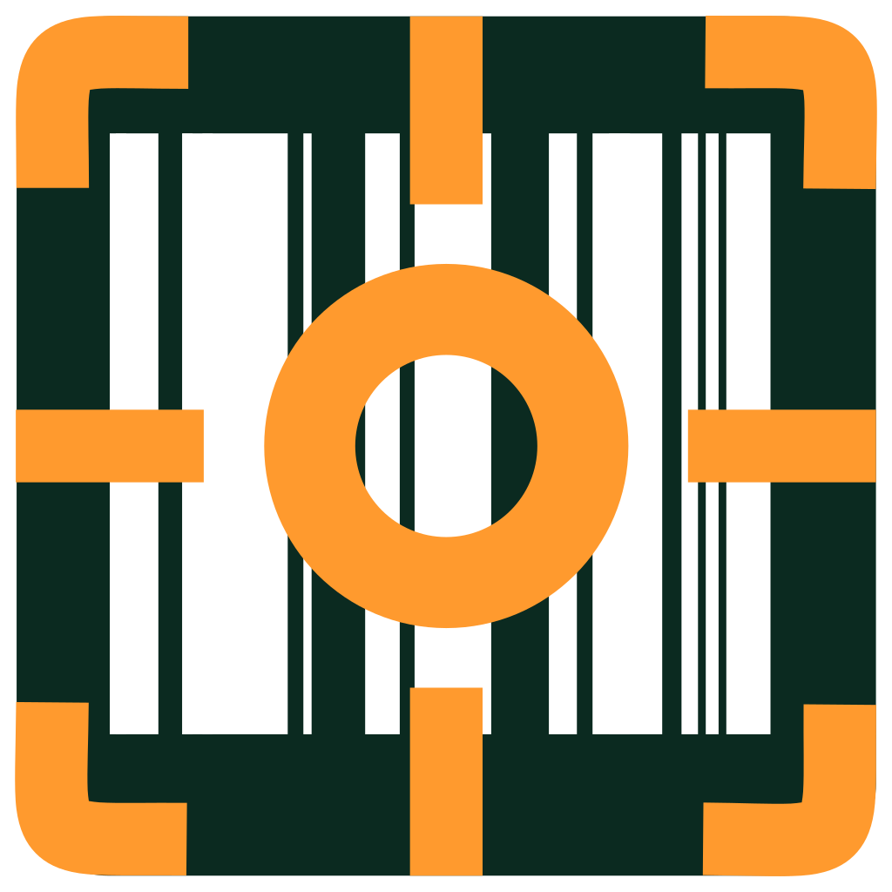
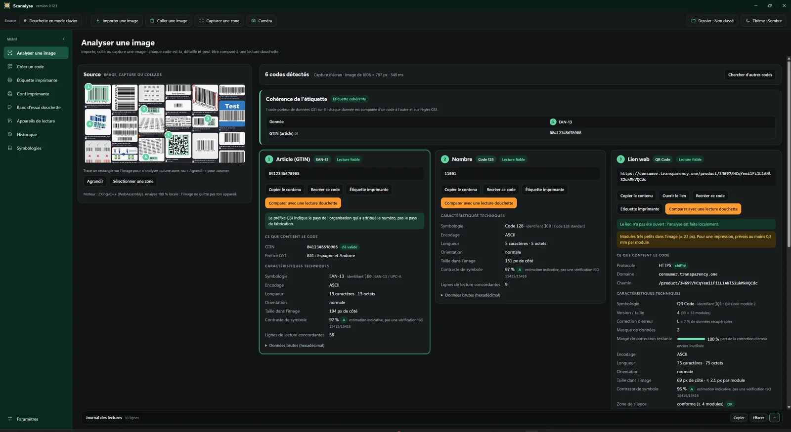
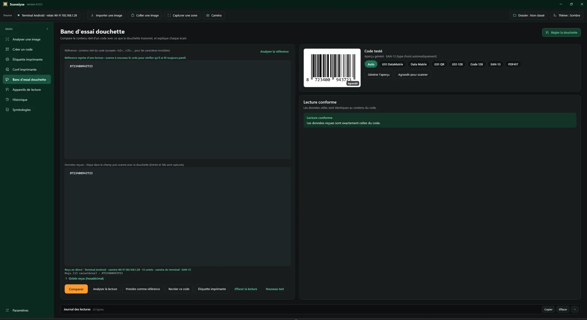
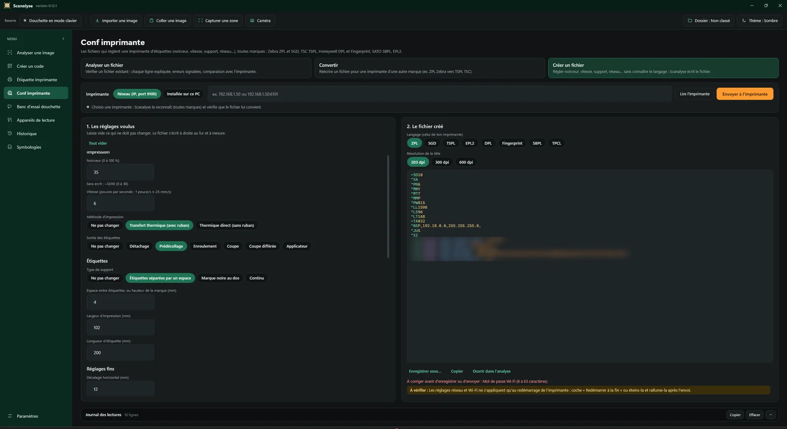
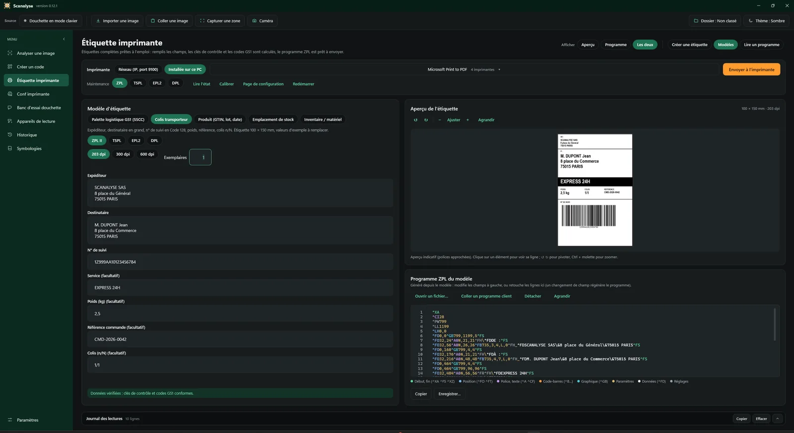
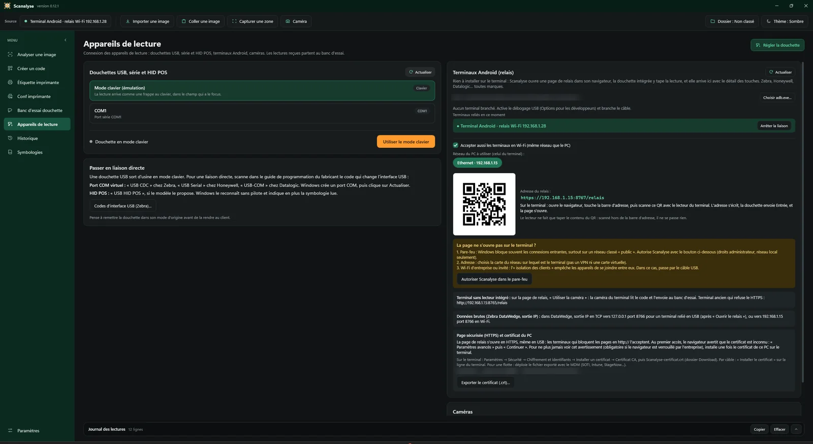

# Scanalyse

**La boîte à outils gratuite du technicien codes-barres.**
Comprendre ce que contient un code, pourquoi une douchette le lit mal, et ce qu'une imprimante d'étiquettes va vraiment imprimer — sur un simple PC Windows, sans installation.

*Free Windows toolbox for barcode support technicians: decode and explain barcodes (GS1, QR, Data Matrix…), test scanners, read and send ZPL / TSPL / EPL2 / DPL / SBPL / Fingerprint label programs. French and English interface.*

[**⬇ Télécharger la dernière version**](https://github.com/Kanard-Compagny/scanalyse/releases/latest) · Windows 10 / 11 · un seul fichier `Scanalyse.exe`, rien à installer

🌐 [Site de Scanalyse](https://kanard-compagny.github.io/scanalyse/) · 🇬🇧 [Read in English](README.en.md)

---

## À quoi ça sert ?

Un client appelle : « la douchette ne lit pas », « l'étiquette sort mal », « le logiciel reçoit n'importe quoi ». Scanalyse aide à trouver **où** ça coince — dans le code imprimé, dans le réglage du lecteur ou dans le programme de l'imprimante — et à le **prouver** avec un rapport.

Il s'adresse aux techniciens SAV, intégrateurs, services informatiques et logistiques, et à tous ceux qui travaillent avec des codes-barres, des douchettes, des terminaux mobiles et des imprimantes d'étiquettes, **quelle que soit la marque**.

## En images

| Banc d'essai douchette | Conf imprimante |
|---|---|
|  |  |
| **Étiquette imprimante** | **Appareils de lecture** |
|  |  |

## Ce que fait Scanalyse

### 🔍 Analyser une image
- Une photo, une capture d'écran ou un PDF du client : **chaque code est lu et expliqué** (lien, Wi-Fi, carte de visite, données GS1 avec leurs dates, lots, numéros de série…).
- Les **erreurs sont signalées** : clé de contrôle fausse, code GS1 mal construit, contraste faible, zone blanche trop petite, codes incohérents sur une même étiquette.
- **Plusieurs images ou un PDF de plusieurs pages** d'un coup, puis un seul rapport.

### 🧪 Banc d'essai douchette
- On scanne un code avec la douchette du client : Scanalyse **compare ce qu'elle transmet au vrai contenu** et explique chaque écart (clavier AZERTY/QWERTY, préfixe ou suffixe en trop, séparateur GS1 perdu…).
- **Codes de configuration** prêts à scanner pour corriger : Honeywell, Datalogic et Zebra (réglages par défaut, clavier français, touche Entrée, interface USB…).

### 📱 Appareils de lecture
- Douchettes USB, série (port COM) et HID POS.
- **Terminaux Android** reliés en USB ou en Wi-Fi : leurs lectures arrivent sur le PC.
- **Terminaux sans lecteur** : leur **caméra sert de douchette**.

### 🖨️ Étiquette imprimante
- **Lire le programme d'un client** en ZPL (Zebra), TSPL (TSC), EPL2, DPL (Honeywell / Datamax), SBPL (SATO) ou Fingerprint (Honeywell / Intermec) : aperçu de l'étiquette, contenu de chaque code, erreurs.
- **Modèles d'étiquettes prêts à l'emploi** (palette SSCC, colis, produit, emplacement, inventaire) dans les quatre langages.
- **Envoyer à l'imprimante** (réseau ou imprimante installée) et **la maintenir** : lire son état (papier, ruban, tête ouverte), calibrer, imprimer sa page de configuration.

### ⚙️ Conf imprimante
- **Analyser un fichier de configuration** avant de l'envoyer : ZPL et SGD Zebra (`! U1 setvar`, JSON), TSPL, DPL, Fingerprint, SBPL, EPL2 et TPCL (Toshiba). Chaque ligne est expliquée, les erreurs sont colorées et des propositions apparaissent pendant la frappe ; fautes de frappe, valeurs hors limites, guillemets copiés depuis Word, ^JUS oublié… sont signalés.
- **Convertir** un fichier vers le langage d'une autre marque, ou **en créer un** à partir d'un formulaire simple.
- **Reconnaissance de l'imprimante** (Zebra, TSC, Honeywell, SATO, Toshiba…) : chaque réglage est vérifié pour ce modèle avant l'envoi.

### ✏️ Créer un code
- Plus de 25 types : QR personnalisé (couleurs, logo), Data Matrix, GS1, EAN, Code 128, PDF417, MaxiCode…
- Export en image et réimpression directe.

### 📁 Historique et rapports
- Chaque analyse est rangée par **dossier client** (dossier SAV).
- **Rapport PDF** à votre en-tête et votre logo, à joindre à l'intervention.
- Historique partageable sur un dossier réseau pour toute l'équipe.

### ⚙️ Pratique au quotidien
- **Français ou anglais**, thème clair ou sombre, adapté aux grands écrans.
- **Mise à jour automatique** depuis cette page.
- **Profil d'équipe** : un fichier pour configurer un nouveau poste en un clic.
- **Tout reste sur le PC** : aucune image ni donnée n'est envoyée sur Internet.

## Démarrer en 2 minutes

1. Téléchargez **`Scanalyse.exe`** depuis la [dernière version](https://github.com/Kanard-Compagny/scanalyse/releases/latest).
2. Lancez-le (si Windows affiche « Windows a protégé votre ordinateur » : *Informations complémentaires* → *Exécuter quand même*).
3. Choisissez la langue, vos dossiers, et suivez la petite visite guidée.

**Prérequis :** Windows 10 (version 2004 ou plus récente) ou Windows 11, 64 bits, avec Microsoft Edge WebView2 (déjà présent sur les Windows à jour).

**Désinstaller :** *Paramètres → Désinstaller* efface les réglages (et vos données si vous le cochez), puis il ne reste qu'à supprimer le fichier.

## Un problème, une idée ?

Ouvrez un **[ticket](https://github.com/Kanard-Compagny/scanalyse/issues/new/choose)** : un problème, un matériel à prendre en charge (toutes marques) ou une idée.
Astuce : *Paramètres → À propos → Copier le diagnostic* donne les informations utiles à joindre.

## Confidentialité

Scanalyse fonctionne entièrement sur le PC : **aucune image, aucun code lu, aucun rapport ni aucune donnée client n'est envoyé sur Internet**, et il n'y a ni compte, ni publicité, ni mesure d'audience.
La seule connexion est la **recherche de mise à jour** sur GitHub (adresse `api.github.com`, sans aucune information personnelle) ; on la désactive dans *Paramètres → Mises à jour* (« Rechercher au démarrage »). Le relais des terminaux Android reste sur le réseau local.

## Sécurité du fichier

`Scanalyse.exe` n'est pas encore signé numériquement : au premier lancement, Windows peut afficher « Windows a protégé votre ordinateur » (*Informations complémentaires* → *Exécuter quand même*).
Chaque version est compilée automatiquement par GitHub Actions à partir du code de ce dépôt, visible de tous ; son **empreinte SHA-256** est publiée avec elle (fichier `Scanalyse.exe.sha256`) et vérifiée par la mise à jour automatique. Pour contrôler un téléchargement : `Get-FileHash Scanalyse.exe` dans PowerShell. Le programme ne contient ni publicité ni mesure d'audience (voir [Confidentialité](#confidentialité)).

## Soutenir le projet

Scanalyse est gratuit et le restera, sans publicité. S'il vous fait gagner du temps, vous pouvez soutenir son développement par un don libre : [paypal.me/MrKanard](https://www.paypal.me/MrKanard). Parler de Scanalyse à vos collègues aide tout autant.

## Licence

Logiciel **libre et gratuit**, créé par **Mr.Kanard**, sous licence [GNU GPL v3](LICENSE) : chacun peut l'utiliser, le partager et l'améliorer, à condition que ses versions restent libres. Fourni sans aucune garantie.
Composants tiers : voir [THIRD-PARTY-NOTICES.md](THIRD-PARTY-NOTICES.md).

Vous voulez contribuer ? Voir [CONTRIBUTING.md](CONTRIBUTING.md) ; pour le code, tout est expliqué dans [docs/DEVELOPPEMENT.md](docs/DEVELOPPEMENT.md).
